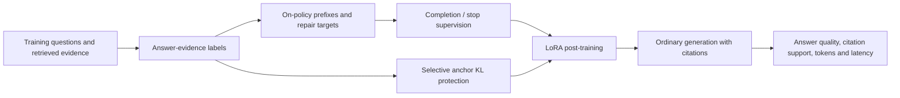

# EQUAL-RAG

**Evidence-aware post-training for concise, complete, citation-grounded answers.**

[简体中文](README.zh-CN.md) · [Method](docs/METHOD.md) · [Results](docs/EXPERIMENTS.md) · [Reproduction](docs/REPRODUCIBILITY.md) · [History](docs/HISTORY.md)

> Research development snapshot · 2026-10-11 · Qwen3-14B focus
>
> This repository documents implemented methods, completed experiments, and diagnostic findings. It is **not** an accepted-paper release or a claim of established superiority. The latest matched-control experiment has completed; its performance confirmation gate has not passed.

## Why this project?

Making a language model answer shorter can also remove necessary answers or their citations. EQUAL-RAG investigates a different objective: **retain useful answer–evidence coverage, repair omissions or citation mistakes, remove redundant continuation, and end only after completion.**

The current work changes post-training, not the retriever. At inference, the model uses ordinary generation with a safety maximum length. There is no method router and no ground-truth answer supplied to the inference policy. “EQUAL” is a project name; no formal acronym expansion is asserted.

## How it works



Training labels approximate support using answer aliases and document annotations. These labels are **not semantic entailment certificates**. Earlier variants used omission, citation-swap, and repetition negatives; later variants investigate completion trajectories, selective retention, explicit EOS, and native-token supervision. See the [method guide](docs/METHOD.md) before reading dated scripts.

## What has been completed?

- Earlier token-saving and cross-model pilots; archived separately from the current RAG direction.
- Evidence-aware training, on-policy repair compilation, teacher-logit caching, matched CE/UL controls, and exact termination telemetry.
- Latest Qwen3-14B round: three training arms, 350 training examples, one seed, **480 development predictions**.
- Fixed-revision automatic citation screening: seven systems, **1,120 existing outputs / 943 unique NLI pairs**; no input truncation.
- Training-site diagnostics, an un-interpolated checkpoint diagnostic, paired bootstrap, multiplicity sensitivity, and a small controlled latency replay.
- Local/server archive integrity verification. This release publishes aggregate results and source hashes, **not the raw archives**.

## Latest results

“Baseline” below is the already-trained anchor, not the unadapted Qwen checkpoint. Both 80-question collections have been reused for development and contain different questions. These are internal splits of an ALCE/QAMPARI source collection, **not official benchmark test scores**.

| Development condition | System | Lexical Q (%) | Mean generated tokens | Full-answer F1 (%) |
|---|---|---:|---:|---:|
| Original development, n=80 | Anchor baseline | 47.285 | 42.513 | 33.664 |
| Original development, n=80 | Current pair method | 47.964 | 39.913 | 33.802 |
| Raw top-5 retrieval development, n=80 | Anchor baseline | 40.580 | 122.538 | 6.083 |
| Raw top-5 retrieval development, n=80 | Current pair method | 47.826 | 131.375 | 6.397 |

Utility is lexical Q divided by mean generated tokens. Its relative change vs. the anchor is **+8.04% [−0.66%, +25.46%]** on original development and **+9.93% [−10.30%, +30.02%]** on raw-retrieval development (question-paired 95% bootstrap intervals). Neither establishes a stable improvement; the current pair method has not demonstrated a reliable advantage over matched CE/UL.

Additional findings:

- Correcting 72 contradictory supervision paths did **not** make EOS the greedy action at the 72 native stop prefixes: **0/72**, including the un-interpolated checkpoint.
- The fixed DeBERTa citation screen did not establish a stable semantic-support improvement. It is not official AutoAIS or human evaluation.
- The 16-question latency pilot did not establish acceleration. Token reduction is not a substitute for serving measurements.
- The latest version has **zero sealed-set predictions and zero human annotations**. Earlier seeds and ablations cannot confirm a changed final version.

The [full result ledger](docs/EXPERIMENTS.md) includes all three matched arms, measurement definitions, uncertainty, invalidated experiments, and unresolved evidence. Aggregate JSON files are under [results/](results/README.md).

## Quick start: inspect results without a GPU

Python 3.10 or newer is sufficient for the result viewer and release verifier. No model downloads or private server access are needed.

```bash
git clone https://github.com/Jjil11/EQUAL-RAG.git
cd EQUAL-RAG
python scripts/show_results.py
python scripts/verify_release.py
```

The repository is currently private, so cloning requires access to the repository. CPU-only metric/compiler tests require NumPy:

```bash
python -m venv .venv
# Linux/macOS: source .venv/bin/activate
# Windows PowerShell: .venv\Scripts\Activate.ps1
python -m pip install -r requirements-analysis.txt
python scripts/run_checks.py
```

These checks validate metric behavior and training-label invariants; they do not rerun the expensive model experiments or establish research performance.

Publication validation: **19 local CPU tests passed**; see [VALIDATION.md](docs/VALIDATION.md) for tested versions and scope. No remote CI or full GPU replay is implied.

## Training and reproduction

The research scripts are dated experimental implementations, **not a fully packaged training SDK**. End-to-end exact replay requires external upstream datasets plus the original prepared labels, anchor adapter, cached logits, and tokenizer-compatible model files. Those assets are not bundled; do not interpret the quick start as exact experiment reproduction.

Read [REPRODUCIBILITY.md](docs/REPRODUCIBILITY.md) for the Linux/CUDA environment, configurable paths, validated historical settings, example commands, dependencies, and missing-asset boundaries. Training supports the latest `action_pair`, `action_ce`, and `action_ul` paths. Historical invalid variants remain clearly identified for auditing, not recommended training.

## Repository structure

```text
EQUAL-RAG/
├── README.md / README.zh-CN.md    # English / Chinese orientation
├── docs/                         # Method, experiment ledger, data and reproduction
├── research/                     # Dated research implementations and historical tests
├── scripts/                      # Lightweight viewer, verifier and CPU tests
├── configs/                      # Recorded latest experiment configuration
├── results/                      # Aggregate metrics, bootstrap and diagnostics
├── examples/                     # Synthetic fixture, not benchmark data
├── tests/                        # Publication checks
├── historical/token_saving/      # Earlier non-RAG research scripts
├── release_manifest.json         # Original/exported source and result hashes
├── CITATION.cff                  # Software citation, no paper/DOI claim
└── LICENSE_STATUS.md             # No open-source license granted yet
```

## Research roadmap

The next proposed experiment is coherent repair-span supervision at real divergence points: syntactic closure, missing supported answers/citations, then EOS. It retains the EQUAL-RAG coverage-protection direction and avoids inference routing. **It has not been launched in this snapshot.**

Before a strong paper claim: establish a Qwen advantage against matched/strong baselines; freeze the final version and confirm with multiple training seeds and untouched evaluation; add an independent real-retrieval task; calibrate semantic citation assessment; complete final-version ablations/robustness; measure serving costs and training amortization. See [ROADMAP.md](docs/ROADMAP.md).

## Data, security, and license

No passwords, access tokens, SSH helpers, private server addresses, weights, teacher caches, retrieved passages, prediction text, or draft manuscripts are intentionally distributed. Third-party data/model assets must be obtained separately under their own terms. See [DATA.md](docs/DATA.md) and [SECURITY.md](SECURITY.md).

The owner has chosen **not to grant an open-source license yet**. Repository access or availability is not a general reuse permission. Upstream dependencies retain their own licenses. See [LICENSE_STATUS.md](LICENSE_STATUS.md).

## Citation and acknowledgments

For this development snapshot, use [CITATION.cff](CITATION.cff); there is no associated accepted paper or DOI claimed. The work uses [ALCE](https://github.com/princeton-nlp/ALCE) data/evaluation concepts, [Qwen3-14B](https://huggingface.co/Qwen/Qwen3-14B), PyTorch, Transformers and PEFT. The exploratory citation screen uses [the DeBERTa NLI checkpoint](https://huggingface.co/MoritzLaurer/DeBERTa-v3-base-mnli-fever-anli). Consult and cite their original publications when using those resources.
